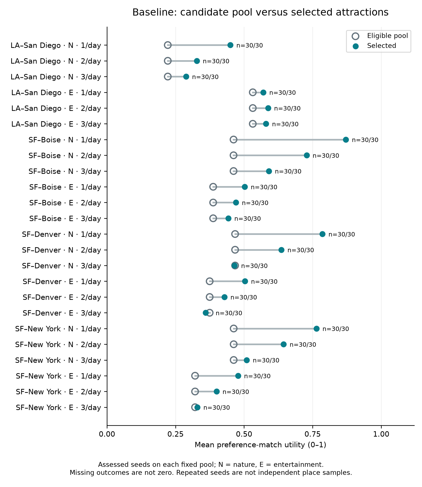
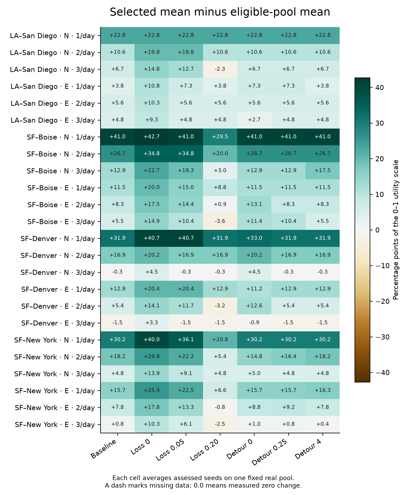

> Superseded by the [nature coverage and rating-audit replacement](../2026-10-24-nature/README.md). Retained as historical evidence; do not use these numbers as the final paper dataset.

# Completed bell-shaped corridor study

Study `514e8250-12c7-4a22-bd2d-e550523fc7dc`, captured and solved using commit `dc231e1c33878487170669a61f621b3591a5f4dd`.
This is the current paper study. The earlier point-sampling and full-trip campaigns are superseded and excluded.

## Protocol and evidence

- Four real initial routes, two personas and three requested-stop densities: 24 scenarios.
- Seven one-factor settings × 30 seeds (0–29): **5,040 solver trials**, all **OPTIMAL**, with no failures or unassessed selections.
- Fifteen-second solve limit, one worker, spacing weight 1; **no candidate-count cap**.
- One admitted catalog snapshot and four measured route pools. Twenty additional scenario captures reused these facts with recomputed persona utility; no provider calls were repeated for seeds or stop densities.
- Continuous full-polyline corridor: 5 miles on either side at endpoints, 25 miles at midpoint, normalized Gaussian sigma 0.25. Progress follows route distance, not driving time.
- Only attraction selection was evaluated. No full-trip planning, scheduling, hotel searches, itinerary construction, budget or actual final-route measurements.
- Catalog generation: `e1dac379fb6863d9c5e8415e925a8394cb9b949919ee835defc564984a406ede`; actual ratings provider: `mentro:Groq/openai/gpt-oss-120b`.
- Complete protocol, all cases, captured place facts/ratings/roads and model/source provenance are stored in PostgreSQL. Public CSV contains per-case measurements; the private full JSON export is 181,303,352 bytes.
- Full JSON SHA-256: `a84188762c6ea358e3648f131e7f92676c8302eb7f45c731ecc25f5b43df7a36`.

## Geographic and solver pools

| Initial route | Geographic matches / measured-road inputs | Solver eligible | Requested stops |
| --- | ---: | ---: | --- |
| Los Angeles–San Diego | 10 | 10 | 1, 2, 3 |
| San Francisco–Boise | 11 | 11 | 2, 4, 6 |
| San Francisco–Denver | 10 | 10 | 3, 6, 9 |
| San Francisco–New York | 24 | 23 | 5, 10, 15 |

**36 distinct real places** occur across these overlapping route pools. The catalog snapshot contains 602 admitted daytime records. One coast-to-coast input is excluded by the selector’s source-calendar validity check; it remains in the captured input evidence. No geometric match was lost to rating batch sizes or arbitrary count limits. The campaign persisted 15 missing trait entries; an independent read verified all 36 distinct inputs against their stored database traits.

All 24 scenarios had enough eligible places: 132 of 132 requested selections per complete 24-scenario pass. This is selection-count fulfillment, not itinerary completion. Eligibility checks do not assess date-specific visit feasibility in this selection-only experiment.

## Baseline utility comparison

Across 720 baseline trials, eligible-pool mean utility was **0.403435** and selected mean was **0.529637**, a difference of **+12.6202 percentage points** on a 0–100 display. These are equal-weight scenario/run means, not an average weighted by the number of selected places.

Twenty-two scenarios improved their mean utility and two decreased it. Both decreases occur on San Francisco–Denver when requesting nine attractions. The model minimizes spacing/deviation and solo detours subject to the quality bound; it does not directly maximize mean utility.

## Parameter comparisons

Each row has 720 OPTIMAL trials over the same 24 frozen scenarios. Utility and estimated road tradeoffs are descriptive; summed solo detours are not actual extra itinerary driving.

| Configuration | Selected mean | Gain (percentage points) | Mean spacing deviation (min) | Mean solo detours (min) |
| --- | ---: | ---: | ---: | ---: |
| baseline | 0.529637 | +12.6202 | 1114.16 | 66.95 |
| quality_loss-0 | 0.601756 | +19.8321 | 1402.17 | 92.94 |
| quality_loss-0.05 | 0.572207 | +16.8771 | 1204.57 | 75.97 |
| quality_loss-0.2 | 0.484637 | +8.1202 | 1043.20 | 61.72 |
| detour_weight-0 | 0.540238 | +13.6803 | 1112.59 | 79.81 |
| detour_weight-0.25 | 0.532970 | +12.9535 | 1112.59 | 69.89 |
| detour_weight-4 | 0.531616 | +12.8181 | 1117.10 | 65.15 |

Reducing the allowed utility loss increases selected utility while generally accepting worse spacing or larger estimated solo detours. Allowing a 0.20 loss reduces average utility and improves those costs. Changing detour weight shifts the relative importance of spacing and solo detours; the selected utility need not move monotonically because utility is a constraint.

All baseline scenarios select the same identities across 30 seeds. Across all seven configurations, 165 of 168 scenario/configuration groups are invariant and three have multiple optimal selections. Repeated seeds are computational repetitions of fixed inputs, not independent travelers or independent place samples.

## Per-scenario baseline values

| Scenario | Requested | Eligible | Pool mean | Selected mean | Gain (points) |
| --- | ---: | ---: | ---: | ---: | ---: |
| short-1d:nature:1 | 1 | 10 | 0.22175 | 0.45000 | +22.825 |
| short-1d:nature:2 | 2 | 10 | 0.22175 | 0.32750 | +10.575 |
| short-1d:nature:3 | 3 | 10 | 0.22175 | 0.28833 | +6.658 |
| short-1d:entertainment:1 | 1 | 10 | 0.53175 | 0.57000 | +3.825 |
| short-1d:entertainment:2 | 2 | 10 | 0.53175 | 0.58750 | +5.575 |
| short-1d:entertainment:3 | 3 | 10 | 0.53175 | 0.58000 | +4.825 |
| medium-2d:nature:1 | 2 | 11 | 0.46159 | 0.87125 | +40.966 |
| medium-2d:nature:2 | 4 | 11 | 0.46159 | 0.72813 | +26.653 |
| medium-2d:nature:3 | 6 | 11 | 0.46159 | 0.59042 | +12.883 |
| medium-2d:entertainment:1 | 2 | 11 | 0.38727 | 0.50250 | +11.523 |
| medium-2d:entertainment:2 | 4 | 11 | 0.38727 | 0.47000 | +8.273 |
| medium-2d:entertainment:3 | 6 | 11 | 0.38727 | 0.44250 | +5.523 |
| long-3d:nature:1 | 3 | 10 | 0.46725 | 0.78583 | +31.858 |
| long-3d:nature:2 | 6 | 10 | 0.46725 | 0.63625 | +16.900 |
| long-3d:nature:3 | 9 | 10 | 0.46725 | 0.46472 | -0.253 |
| long-3d:entertainment:1 | 3 | 10 | 0.37450 | 0.50333 | +12.883 |
| long-3d:entertainment:2 | 6 | 10 | 0.37450 | 0.42833 | +5.383 |
| long-3d:entertainment:3 | 9 | 10 | 0.37450 | 0.35944 | -1.506 |
| coast-5d:nature:1 | 5 | 23 | 0.46207 | 0.76400 | +30.193 |
| coast-5d:nature:2 | 10 | 23 | 0.46207 | 0.64425 | +18.218 |
| coast-5d:nature:3 | 15 | 23 | 0.46207 | 0.50983 | +4.777 |
| coast-5d:entertainment:1 | 5 | 23 | 0.32130 | 0.47800 | +15.670 |
| coast-5d:entertainment:2 | 10 | 23 | 0.32130 | 0.39950 | +7.820 |
| coast-5d:entertainment:3 | 15 | 23 | 0.32130 | 0.32967 | +0.836 |

## Timing and limits

Mean solver time across all 5,040 trials was **10.3315 ms**. Mean trial wall time was **43.7680 ms**, which additionally includes capture-hash validation and model preparation. Solver median was 2.001 ms (range 0.290–242.078 ms); trial median was 28.8718 ms (range 14.0511–310.7533 ms). Timing is not full-trip latency.

Hardware: Apple M4 Pro, 12 logical CPUs, 24 GiB RAM; Python 3.12.14, OR-Tools 9.10.4067, one solver worker. Local container validation was finished and its containers stopped before controlled solver trials. Preparation was paused between jobs for that verification; this administrative pause is not solver time.

The 5- and 25-mile widths and Gaussian shape are chosen experimental rules, not empirically optimal thresholds. The active catalog’s geographic coverage remains limited. All-optimal results on 10–23 eligible places do not establish large-instance scaling, subjective satisfaction, opening-hours feasibility, or a feasible final itinerary. AI ratings are estimates even though identities, source facts, stored scores and road responses are real.

## Reproduction and files

- [Analysis script](analyze_export.py): verifies completion, capture hashes, corridor membership, pool invariance across personas/stop counts, selected identities/counts, utility arithmetic and quality bounds; then generates both figures.
- [Per-case CSV](case-results.csv): 5,064 queue items, with 5,040 solver rows. Filter `track=solver` for experiment outcomes.
- [Machine-readable summary](summary.json): exact aggregates, matched comparisons, source/model identities, hashes and scenario results.
- [Input audit](input-audit.json): independently recomputed eligible-pool means/identities and source-calendar exclusions.
- [Paper handoff](paper-alignment.md): updated implementation claims and writing constraints.

Run the analysis script with the complete private study JSON export as its only argument. It writes summary and figures alongside that export. The raw JSON is intentionally not committed; the database and private export preserve the complete evidence.
