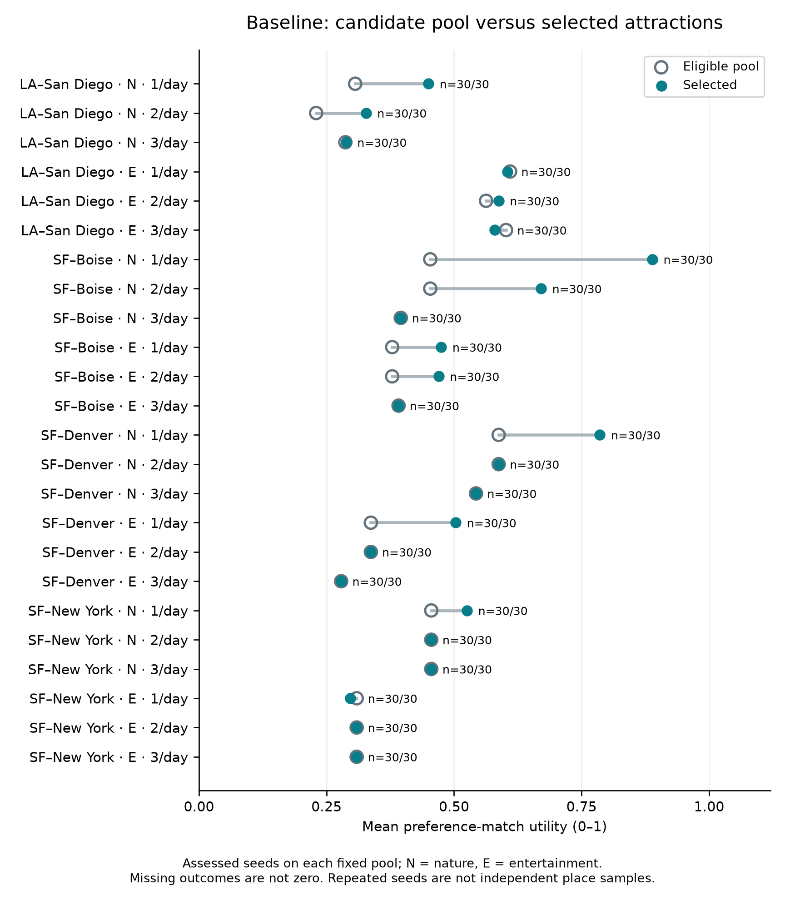
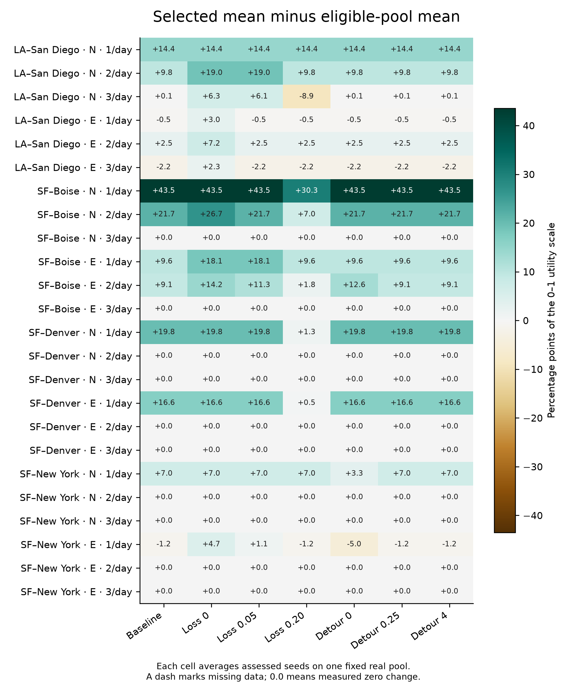

# Real-data selection results, October 24, 2026

**Superseded protocol:** the user subsequently requested an uncapped bell-shaped
route corridor. These schema-v3 results remain historical evidence and must not
be combined with, or presented as results of, the revised corridor study.

Study `05fc366d-4623-4467-ba06-a93911147993` completed from clean backend source
`dec327426244f10e4c3c34bb7fd00177224586a7`. Its 24 real input captures and all 5,040
CP-SAT trials are saved in PostgreSQL. All solver trials returned OPTIMAL; no
failed, blocked, empty or missing trials occurred. No full trips were planned
or evaluated by this study. The earlier cancelled combined study and preflights
are excluded. These are measurements, not fixture examples.

## Protocol and data

- Four routes × two personas × three requested stop densities = 24 scenarios.
- Seven one-factor settings × 30 seeds (0–29) = 210 solver trials per scenario.
- Fifteen-second solver limit, one search worker, candidate cap 60.
- Fixed departure: October 31, 2026 at 08:00 in the origin time zone.
- Collection/trials ran 2026-10-24T21:41:09.197766+00:00 through 2026-10-24T21:52:51.273559+00:00.
- Actual pools: 4–8 eligible places (mean 5.75), 20 distinct places across all pools.
- Active catalog generation: `e1dac379fb6863d9c5e8415e925a8394cb9b949919ee835defc564984a406ede`.
- Actual estimated-rating provider/model: `mentro:Groq/openai/gpt-oss-120b`.
- Raw candidate facts, source provenance, ratings, road measurements and hashes
  are in the database capture records. Captures were frozen before trial runs.

## Candidate versus selected utility

The default configuration averaged **0.417234** utility over the eligible pools
and **0.479866** over selected attractions: **+0.062632 utility**, or **+6.2632
percentage points** on a 0–100 display. These are equally weighted means across
24 scenarios, each repeated with 30 solver seeds (720 baseline trials). This is
not an average over 720 independent place samples or observed travelers.

Eleven baseline scenarios increased mean utility, three decreased it, and ten
had no change. Negative changes are allowed: utility is protected by the top-K
quality bound while the objective minimizes spacing deviation and solo detours.

Each row is one scenario; hollow gray and solid teal markers coincide when the
means are equal. The figure uses assessed results only, with all 30 seeds present.

## Parameter sweeps

Each setting below has 720 OPTIMAL trials over the same 24 captures. Spacing and
solo detours are selection-model quantities, not actual extra itinerary driving.

| Setting | Selected mean utility | Pool-to-selected change (points) | Mean spacing deviation (minutes) | Mean summed solo detours (minutes) |
| --- | ---: | ---: | ---: | ---: |
| Default (loss .10, detour 1) | 0.479866 | +6.2632 | 1132.84 | 41.35 |
| Loss 0 | 0.501821 | +8.4587 | 1179.15 | 46.13 |
| Loss .05 | 0.491606 | +7.4372 | 1144.42 | 43.16 |
| Loss .20 | 0.446932 | +2.9698 | 1131.19 | 38.57 |
| Detour 0 | 0.478200 | +6.0965 | 1132.84 | 42.42 |
| Detour .25 | 0.479866 | +6.2632 | 1132.84 | 41.35 |
| Detour 4 | 0.479866 | +6.2632 | 1132.84 | 41.35 |

On 720 matched scenario/seed pairs, zero allowed quality loss increased selected
mean utility by 2.1955 points relative to baseline, with 46.3057 more minutes of
baseline spacing deviation and 4.7773 more minutes of summed solo detours on
average. Allowing loss .20 decreased selected mean utility by 3.2934 points,
reduced spacing deviation by 1.6562 minutes and reduced summed solo detours by
2.7806 minutes. These differences describe these small frozen pools only.

Detour weights .25, 1 and 4 produced the same aggregate selection measurements.
Removing the detour penalty changed some selections and increased average summed
solo detours by 1.0726 minutes, while average spacing deviation was unchanged.
All 30 seeds selected the same identities within every scenario/configuration;
computational repetition does not establish independent statistical replication.

## Coverage and fulfillment

These are fresh route-based captures, not a new fixed set of 100 places. Discovery
sampled five-mile neighborhoods along each baseline route. Twenty of the 24
captures exhausted their search-count allowance; four reached the discovery
target. Their recorded raw pools, successful ratings, positive-utility shortlists
and road-verified pools all contained the same 4–8 places. No additional calendar
exclusions were recorded at this discovery stage. Thus the candidate cap was not
the bottleneck, and increasing that cap alone would not enlarge these inputs.
Provider-level catalog admission rules still apply before these recorded pools.

Ten scenarios had fewer candidates than requested. In these scenarios the model
selected the entire eligible pool, so changing utility allowance or detour weights
could not change the chosen subset. Fourteen scenarios could fulfill the requested
count. This is selection-count fulfillment, not successful itinerary delivery.

Across one complete pass through all scenarios, 90 of 132 requested selections
were available (68.18% when weighted by requested count). The unweighted mean of
per-scenario selected/requested ratios was 82.87%; these denominators differ.

| Scenario | Requested | Eligible | Selected | Candidate mean | Baseline selected mean | Change (points) |
| --- | ---: | ---: | ---: | ---: | ---: | ---: |
| short-1d:nature:1 | 1 | 4 | 1 | 0.30625 | 0.45000 | +14.375 |
| short-1d:nature:2 | 2 | 8 | 2 | 0.22969 | 0.32750 | +9.781 |
| short-1d:nature:3 | 3 | 5 | 3 | 0.28700 | 0.28833 | +0.133 |
| short-1d:entertainment:1 | 1 | 4 | 1 | 0.61000 | 0.60500 | -0.500 |
| short-1d:entertainment:2 | 2 | 8 | 2 | 0.56281 | 0.58750 | +2.469 |
| short-1d:entertainment:3 | 3 | 5 | 3 | 0.60200 | 0.58000 | -2.200 |
| medium-2d:nature:1 | 2 | 8 | 2 | 0.45344 | 0.88875 | +43.531 |
| medium-2d:nature:2 | 4 | 8 | 4 | 0.45344 | 0.67063 | +21.719 |
| medium-2d:nature:3 | 6 | 4 | 4 | 0.39563 | 0.39563 | +0.000 |
| medium-2d:entertainment:1 | 2 | 8 | 2 | 0.37875 | 0.47500 | +9.625 |
| medium-2d:entertainment:2 | 4 | 8 | 4 | 0.37875 | 0.47000 | +9.125 |
| medium-2d:entertainment:3 | 6 | 4 | 4 | 0.39125 | 0.39125 | +0.000 |
| long-3d:nature:1 | 3 | 5 | 3 | 0.58750 | 0.78583 | +19.833 |
| long-3d:nature:2 | 6 | 5 | 5 | 0.58750 | 0.58750 | +0.000 |
| long-3d:nature:3 | 9 | 4 | 4 | 0.54312 | 0.54312 | +0.000 |
| long-3d:entertainment:1 | 3 | 5 | 3 | 0.33700 | 0.50333 | +16.633 |
| long-3d:entertainment:2 | 6 | 5 | 5 | 0.33700 | 0.33700 | +0.000 |
| long-3d:entertainment:3 | 9 | 4 | 4 | 0.27875 | 0.27875 | +0.000 |
| coast-5d:nature:1 | 5 | 6 | 5 | 0.45542 | 0.52550 | +7.008 |
| coast-5d:nature:2 | 10 | 6 | 6 | 0.45542 | 0.45542 | +0.000 |
| coast-5d:nature:3 | 15 | 6 | 6 | 0.45542 | 0.45542 | +0.000 |
| coast-5d:entertainment:1 | 5 | 6 | 5 | 0.30917 | 0.29700 | -1.217 |
| coast-5d:entertainment:2 | 10 | 6 | 6 | 0.30917 | 0.30917 | +0.000 |
| coast-5d:entertainment:3 | 15 | 6 | 6 | 0.30917 | 0.30917 | +0.000 |

## Timing and limitations

Solver wall time across all 5,040 trials averaged 0.4241 ms
(median 0.2460 ms; range
0.1090–1.8230 ms).
Trial wall time additionally includes capture-hash validation and model preparation:
mean 29.166 ms, median 23.323 ms.
The host was an Apple M4 Pro with 12 logical CPUs and 24 GiB RAM; the solver
used one worker. The 15-second cap was never approached. With only 4–8 candidates, this study does
not demonstrate performance at the configured 60-candidate limit.

Large spacing deviations on long routes reflect the supplied pool locations.
Optimality is conditional on those candidates and the encoded objective. The
catalog, discovery strategy, source-calendar rules, fixed departure and AI trait
estimates limit generalization. Pools overlap (20 distinct places total), and
scenarios at different requested densities can discover different pools.

No human satisfaction, full-trip feasibility, actual itinerary distance/driving,
hotel availability, trip duration or budget outcome was measured. The ordinary
application still implements downstream scheduling, but it is outside this study.

## Files and audit

- [Case CSV](case-results.csv): all 5,064 preparation/trial records; filter `track=solver` for the 5,040 solver trials.
- [Summary JSON](summary.json): exact denominators, per-scenario/configuration statistics and source/model identities.
- [Paper alignment](paper-alignment.md): verified source claims, corrections and writing constraints.
- [Analysis script](analyze_export.py): checks capture hashes, selected identities/counts, recomputed selected utility, quality bounds, scope and completion before producing figures.
- PNG figures are high-resolution; matching SVG files retain editable vector content.

The complete 159 MB JSON evidence export stays in PostgreSQL and the private local
export directory. It is not committed here. From Research, export JSON as
`study.json`, then run the analysis script with that path in a Python environment
containing Matplotlib and NumPy. The script writes derived files beside the export.

Local/CI validation passed at the study source: frontend 294 tests/build/lint/format;
backend 2,151 tests, 139 environment-dependent skips, 80.61% coverage, Ruff; guarded
preview smoke 2/2; exact-head CI container and real PostgreSQL CRUD/recovery checks.
An additional targeted UI check covers the clarified valid-selection labels.

Analysis environment: Python 3.12.14, Matplotlib 3.11.2, NumPy 2.5.4.
Full input-export SHA-256: `ed70dbd198c2b34f687b16a4f3a5c9dba6bc37e23910af79e976481974d20d93`.
