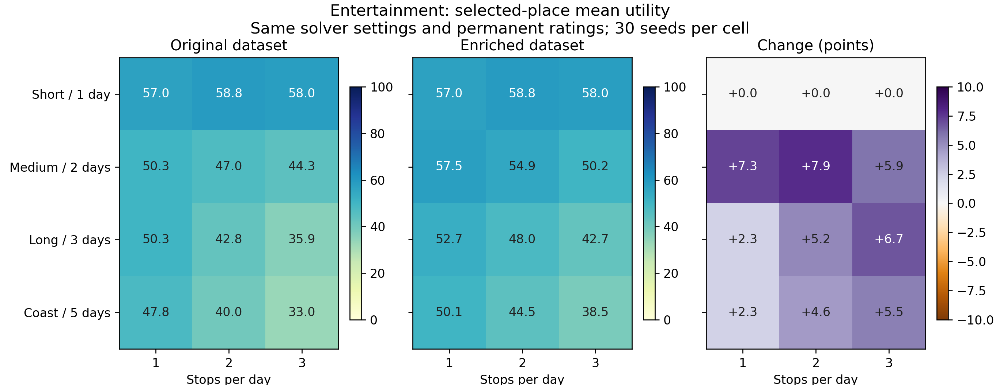

# Entertainment coverage study — October 25, 2026 UTC

Current study: `1ca40240-107e-4817-ab8b-bc461e0d26f6`. Source revision:
`9619c755e15bf1636bfd548b8a7b49391a37143e` (clean checkout), source snapshot
`290c73f6e63aeaa6b6b79f1499dc89e85cfb5c49db0f745fba384f6958415c30`.

The catalog grew from **611 to 627 places**, with sixteen new real destinations
and sixteen calendars. Every original catalog row, calendar and rating row is
unchanged. All thirteen ratings created in the first enrichment batch also remain
unchanged. The sixteen additions were rated once through
`mentro:Groq/openai/gpt-oss-120b`; the final study itself made **zero AI rating
calls or writes**. Fourteen additions lie in the unchanged study corridors, and
two remain general catalog entries outside those corridors. There are 55 unique
rated identities in storage and 53 captured by this study.

## Protocol and outcomes

- Real-data attraction selection only: no budget measurement, hotels, itinerary
  scheduling or full-trip evaluation.
- Four routes × two personas × three stop rates = 24 captures. Thirty seeds and
  seven paper settings produce 5,040 solver trials; each has a 15-second limit.
- Continuous bell corridor: 5 miles at endpoints, 25 miles at midpoint, sigma
  0.25, and no candidate-count cap. One frozen real pool per route is reused.
- Solver outcomes: {"OPTIMAL": 5040}. Baseline outcomes:
  {"OPTIMAL": 720}. Database verification matches all 5,064 local
  records exactly. All outcomes, including any unsuccessful trials, are retained.
- Requested stops per seed: 132; selected: 132.
- Baseline candidate-pool mean: 0.352542737; selected mean:
  0.586428819; within-pool selection gain:
  +23.388608 percentage points.
- Baseline seed-invariant selections in every scenario: True. Repeated
  seeds are not independent samples of places or evidence of statistical
  significance.
- Baseline route geometry is identical to the original study. Refreshed routing
  estimates differ by 1.483–3.293 seconds per route; this is a live-provider
  before/after comparison, not an exactly frozen routing-time counterfactual.
  Exact per-route checks are in `ratings-verification.json`.

## Entertainment before and after

Values are selected-place mean utility on the 0–100 display scale, with the
change in percentage points in parentheses. These compare the same default
solver settings against the prior fixed-rating study
`cffa789a-bd7c-4ec0-8be0-8223e1cff9bc`.

| Trip | 1 stop/day | 2 stops/day | 3 stops/day |
| --- | --- | --- | --- |
| Short single day | 57.0 → 57.0 (+0.0) | 58.8 → 58.8 (+0.0) | 58.0 → 58.0 (+0.0) |
| Medium two-day | 50.3 → 57.5 (+7.3) | 47.0 → 54.9 (+7.9) | 44.3 → 50.2 (+5.9) |
| Long three-day | 50.3 → 52.7 (+2.3) | 42.8 → 48.0 (+5.2) | 35.9 → 42.7 (+6.7) |
| Coast to coast | 47.8 → 50.1 (+2.3) | 40.0 → 44.5 (+4.6) | 33.0 → 38.5 (+5.5) |

Display rounding uses decimal half-up; exact unrounded means are retained in JSON.

Adding places also changes the candidate-pool mean. The within-pool gain must
not be confused with a cross-dataset improvement or attributed to a solver code
change. `ratings-verification.json` compares all 24 selected-place means directly.
There are 4 decreasing cells across both personas; those results are
retained rather than averaged away or described as universal improvement.

## Why some nature averages decrease

The unchanged model minimizes spacing deviation plus measured solo detours,
subject to a mean-utility lower bound within ten points of the best available
mean. It does not maximize mean utility as its final objective. New geographically
dispersed options can therefore change the selected set even with identical
per-place profiles. In the long-route nature case with two stops/day, the initial
baseline example changes from 63.625 to 58.542 while the best available mean stays
66.958. Its largest baseline gap falls from 16.13 to 8.27 driving hours. This is an
allowed selection tradeoff, not a rating change. These are selection diagnostics,
not proof of a feasible daily itinerary. Full selected-place examples and exact
values are in `selection-examples.json`.

## Dataset engineering and limitations

The first batch added thirteen cultural/food venues. Its complete intermediate
study `021f5329-e4f2-41a7-84cb-83c07566c84f` produced all
5,040 OPTIMAL trials and is retained in the `intermediate-*` files and private
complete export. Its early results motivated a second batch of three food halls
with drinks and social/cultural activities. Each batch was selected before
rating its own additions. No low-rated additions were discarded. This is targeted,
adaptive dataset engineering, **not a blinded holdout evaluation**.

The permanent ratings preserve their original model/rubric provenance. They are
persona-independent AI estimates, not independently validated unbiased ground
truth. New data do not establish generalization to arbitrary regions or dates.
Published visitor hours are bounded to the reviewed thirty-day horizon, and
ordinary access does not guarantee individual events or every vendor's service.

See [source review and recovery](../../catalog-entertainment-refresh-20261025.md)
for venue URLs, held candidates, native locations, scope exclusions, generation
fingerprints and restored backups. The previous ratings-restoration packet remains
historical evidence at [the prior study](../2026-10-24-restored/README.md).

## Reproduction and verification

The full private JSON export SHA-256 is `bc7f7f6e513542290cc1a9f369ded286ef5f9a47c12f61c53b511a85ac6533a7`.
`analyze_export.py` verifies all capture hashes, fixed route pools, corridor
membership, measured selected means and quality bounds before generating the
summary and plots. `plot_dataset_comparison.py` renders the directly audited
before/after table. CSV results contain all 5,064 records. The database stores the
catalog, original permanent profiles, first ratings for new identities, protocol,
captures and every solver result; private raw acquisition bytes support replay.

Validation on the final application source: Ruff 0.16.7 format and lint; 2,248
backend tests passed, 73 skipped, 82.27% coverage (63% gate unchanged). The skipped
checks retain their environment/private-source requirements. Disposable PostgreSQL
checks passed separately from hosted-data recovery. All GitHub CI checks passed
on source revision `9619c75`, including frontend tests/build, container smoke and
real PostgreSQL CRUD/recreate/backup/restore. This feature remains a draft PR to
`develop`; no main merge or production API deployment occurred.
