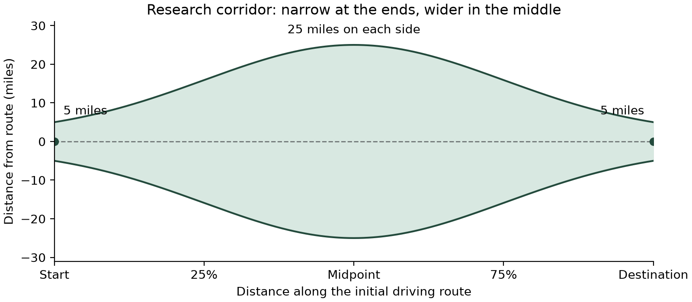

# Studio selection research

`/studio/research` compares CP-SAT attraction selections using real catalog places,
persisted AI-estimated traits and measured road inputs. Research does not run full
trip planning, hotel searches, scheduling, itinerary construction or final-route
validation. Budget inputs, measurements and the old tight-budget scenario are
removed from research. Ordinary trip planning remains available in Studio.

## Protocol

The October 24 selection-only protocol (`schema_version: 4`) covers:

| Route | Target days used to calculate requested stops | Requested attractions |
| --- | ---: | --- |
| Los Angeles–San Diego | 1 | 1, 2, 3 |
| San Francisco–Boise | 2 | 2, 4, 6 |
| San Francisco–Denver | 3 | 3, 6, 9 |
| San Francisco–New York | 5 | 5, 10, 15 |

Two explicit personas (nature and entertainment) and three stop densities yield
24 scenarios. The requested departure is fixed for each study (default seven days
later at 08:00 local time). Target days determine the requested attraction count;
they are not a scheduled trip duration. The selector retains its source-calendar
validity and positive-utility checks, but this selection-only study does not assess
date-specific opening windows, visit durations or final itinerary feasibility.

Each scenario has one input-collection job followed by 210 controlled solver
trials: seven distinct configurations × 30 seeds (0–29). There are **24 captures
and 5,040 solver trials**, or 5,064 queue items. Input collection is preparation,
not a full-trip evaluation or an additional solver trial.

All solver configurations use a **15-second limit**, **no candidate-count cap**,
one search worker and spacing weight 1. Every geographic match is considered;
scarce real pools are never padded with invented places. Ordinary app discovery
retains its existing limits; the revised corridor protocol is research-only.

| One-factor sweep | Values | Other setting |
| --- | --- | --- |
| Absolute mean-utility loss allowance | 0, 0.05, 0.10, 0.20 | Detour weight 1 |
| Detour weight | 0, 0.25, 1, 4 | Utility-loss allowance 0.10 |

The shared default (loss 0.10, detour weight 1) appears once, yielding seven
configurations. `app/research/design.py` owns the validated design and seeded run
order. Unsupported full-trip/repeat options are rejected by the API.

## Real input collection

`app/research/collect.py` resolves the route endpoints and measures the initial
route using existing live providers. `app/catalog/repository.py:routing_snapshot`
reads all admitted daytime places from one immutable active generation, without
a SQL result limit. `app/routing/corridor.py` checks every route segment, not
scattered search points. Membership does not depend on persona or requested stops.

For a place's nearest projection onto the road polyline, let `p` be the fraction
of total baseline polyline distance (0 at the start, 1 at the end). The allowed
one-sided distance is a normalized Gaussian:

```
g(p) = exp(-0.5 * ((p - 0.5) / sigma)^2)
r(p) = endpoint + (midpoint - endpoint) * (g(p) - g(0)) / (1 - g(0))
include iff distance_to_route <= r(p)
```

Defaults are **5 miles at either endpoint, 25 miles at the midpoint, sigma 0.25**.
The width applies on both sides (50 miles total at the middle). It is a deterministic
geographic rule, not random sampling or a probability. Design fields
`corridor_endpoint_miles`, `corridor_midpoint_miles` and `corridor_sigma` configure
and freeze it. Distances use the existing local segment projection followed by a
WGS84 geodesic measurement; progress uses polyline length rather than driving time.
Ties at crossings choose the earliest occurrence. The radius is evaluated at the
nearest projection; a farther, wider part of the route cannot admit the place.



Every geographic match receives persisted AI trait ratings. Requests are batched
in groups of at most five, but all groups are processed. Missing or unpersisted
traits fail preparation instead of silently reducing the pool. The AI supplies
ratings only; it does not suggest places or determine geographic membership.
Each candidate's solo origin–candidate–destination road route is measured, and
unusable-road exclusions remain in the evidence.

`app/research/preparation.py` freezes one catalog snapshot and four measured route
pools per study. The 24 scenario captures reuse those same route/trait/road facts;
only persona utility arithmetic and the requested selection count change. Stored
hashes and exclusive intent/result files prevent accidental recapture after a
restart. Twenty reused scenario preparations make no provider calls. Collection
never calls the full planner, scheduler or itinerary builder. At most two route
preparations run concurrently, followed by one solver trial at a time.

`app/research/evidence.py` validates catalog generation/source provenance and the
persisted rating provider/model/timestamp, recalculates utility from the frozen
persona and ratings, and hashes the capture. All supplied records, including any
selector exclusions, remain available for auditing. A measured empty pool remains
an empty capture; absent or invalid evidence blocks the associated trials.

The active source catalog and its admission/calendar holds are preserved. Newly
encountered places receive valid estimated traits from the configured AI gateway;
traits are stored in `place_attribute_traits`, then reused across scenarios.
Utility is recomputed for each persona. The cache contract
`attraction-traits-v2-model-provenance` refreshes traits with unknown model identity.
The verified gateway provider/model is `mentro:Groq/openai/gpt-oss-120b`; every
capture retains its actual provider/model rather than assuming that never changes.

These are real place records and measured road responses. Attribute scores remain
AI estimates, not measured traveler satisfaction. Unit/offline fixtures never
participate in the empirical study; frozen offline providers explicitly disable
the live trait cache.

## Measurements and charts

The selector chooses `K = min(requested, eligible)` attractions. It protects mean
utility with the absolute bound `selected mean >= top-K mean - allowance`, then
minimizes spacing deviation plus weighted estimated solo detours. Utility itself
is not the directly maximized objective.

For every assessed selection, research records:

- Eligible candidate-pool mean utility, selected mean, and their paired difference.
- Best available top-K mean, quality loss, selected utility values/minimum/median/maximum.
- Requested, eligible and selected counts, plus selected/requested fulfillment.
- Total baseline spacing deviation, longest baseline gap and summed estimated solo detours.
- Solver status, solve time, model-and-solve time, objective and best bound.
- Configuration/seed, source revision/hash, capture hash and start/end timestamps.

The paired utility chart shows candidate versus selected means, plus the best
available mean, with assessed sample counts. The heatmap includes utility change,
spacing and estimated detour measures. A valid OPTIMAL/FEASIBLE selection remains
assessed even when the real pool contains fewer places than requested; fulfillment
shows that shortage separately. Missing results stay missing rather than zero.

OPTIMAL, FEASIBLE, INFEASIBLE, UNKNOWN, MODEL_INVALID, EMPTY and NOT_RUN remain
distinct. Zero utility-loss tolerance can be infeasible due to conservative integer
rounding. Optimality applies to the supplied selection model and pool, not to every
possible trip. Repeated seeds share a frozen pool and are not independent place or
traveler samples. Actual added driving/distance, hotel outcomes, trip duration and
itinerary completion are not measured or reported.

## Persistence, recovery and operation

The private SQLite queue lives under `.artifacts/studio-research` (or
`STUDIO_RESEARCH_DIR`). Existing PostgreSQL tables `studio_research_studies` and
`studio_research_runs` retain the protocol, all cases and results. Capture rows
contain `capture` and full `capture_evidence`; solver rows reference their capture
hash and retain selected identities/solver diagnostics. JSON exports include the
full evidence in `protocol.cases`; CSV exports contain per-trial measurements.
Lightweight chart snapshots omit bulky evidence objects. No new SQL schema is
required. The protocol's `dataset_hash` identifies the capture specification;
each solver result's `dataset_hash` identifies its actual frozen input.

`STUDIO_RESEARCH_ENABLED`, `STUDIO_RESEARCH_DATABASE` and
`PLACE_TRAITS_CACHE_ENABLED` must be enabled locally; deployment defaults remain
disabled. Valid Studio sessions can read database results across browsers. Private
study capabilities control execution. The selection-only cache namespace prevents
removed historical/full-trip studies from reappearing through old browser caches.

Capture intent/result files prevent a restart from silently repeating provider
calls. Three consecutive infrastructure/provenance failures pause unstarted work.
Source-hash changes prohibit resuming a campaign against different application
code. The detached macOS worker uses `caffeinate`; the computer must remain on.

From `backend/` with the configured development environment:

```sh
.venv/bin/python -m app.research.manage create --control-file /absolute/private/new-study.json
.venv/bin/python -m app.research.manage status STUDY_UUID
```

Creation validates persistence opt-ins, saves the immutable protocol and private
control key, mirrors it to PostgreSQL and starts execution. `manage remove
--study-id UUID --backup /absolute/new/recovery-directory` backs up named inactive
studies and associated records, serializes against mirror writes and deletes only
those studies from active stores. It refuses active workers. Recovery copies never
participate in charts or paper results.

The three original studies and the subsequently cancelled full-trip study were
removed after private recovery copies. The cancelled study is not part of the
selection-only experiment. Software checks and live preflights are separate from
paper observations; see [validation](container-validation.md).

The completed October 24 selection-only study and its audited figures/tables are
in [the results packet](research/2026-10-24-selection/README.md).
